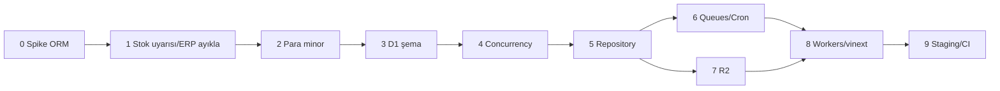

# Cloudflare uyarlama planı

**Dal:** `cloudflare-adaptation`  
**Proje:** Kaplan Turşu e-ticaret  
**Hedef runtime:** Cloudflare Workers + D1 + R2 + Queues / Cron

Bu belge, mevcut Next.js + PostgreSQL + Prisma + pg-boss yığınını Cloudflare-native yapıya taşıma yol haritasıdır.

---

## 1. Hedef mimari

```
İstek → Cloudflare Workers (Next / vinext)
              │
              ├─ D1          → uygulama verisi
              ├─ R2          → ürün / içerik görselleri
              ├─ Queues      → e-posta ve asenkron işler
              ├─ Cron        → süresi dolan sipariş, bakım
              └─ Turnstile   → bot koruması (isteğe bağlı, features.captcha)
```

| Bugün | Hedef |
|-------|--------|
| Node + `next start` | Workers (vinext) |
| PostgreSQL + Prisma `pg` | **D1** |
| Yerel disk (`UPLOAD_DIR`) | **R2** |
| `pg-boss` + `npm run worker` | **Queues** + **Cron Triggers** |
| Docker Compose (Postgres, Mailpit) | `wrangler dev` + local D1/R2 |

DNS, SSL ve domain Cloudflare üzerinden yönetilir.

---

## 2. Kapsam

### Dahil

- D1 şema ve repository uyarlaması
- Para alanlarının kuruş (`INTEGER`) modeline geçişi
- Stok / kredi limiti concurrency (D1-uyumlu)
- R2 dosya depolama adaptörü
- JobQueue → Cloudflare Queues + Cron
- Workers runtime (vinext), auth hash uyumu
- Staging deploy ve müşteri preview
- Dev / CI akışının Cloudflare araçlarına kayması

### Bilinçli olarak kapsam dışı

| Konu | Gerekçe |
|------|---------|
| **Stok uyarısı** (“gelince haber ver”, `stock-alerts`, sweep job) | Bu müşteri projesinde kullanılmayacak; migrasyonda taşınmaz, UI/job bağları kaldırılır veya ölü kod olarak bırakılmaz |
| **ERP senkronu** | `features.erp` zaten kapalı; Queue/Cron’a taşınmaz |
| Dış managed Postgres / Hyperdrive / PlanetScale | Karar: **yalnız D1** |
| PHP / paylaşımlı web hosting | Stack ile uyumsuz |
| Production PayTR live kesimi | Staging’de test/sahte ödeme; live ayrı go-live checklist |

Şablondaki `modules/stock-alerts`, `modules/erp` ve ilgili worker job kayıtları bu dalda **çıkarılır veya feature’sız bırakılıp deploy yolundan silinir** (tercihen kod ve cron’dan temizlenir).

### Kuyrukta kalacak işler (bizim ihtiyaç)

1. **E-posta gönderimi** (`email.send`) — asıl asenkron yük  
2. **Süresi dolan sipariş / rezervasyon temizliği** — Cron (ör. her 5 dk)  
3. **Bakım** — rate limit ve audit log purge — Cron  

---

## 3. Sabit teknik kararlar

1. **Veritabanı = D1 (SQLite).** Postgres migration zinciri taşınmaz; D1 için yeni baseline.
2. **Para = minor birim (kuruş).** DB’de `Int`; hesap/görüntüleme `src/shared/money.ts` üzerinden.
3. **ORM:** Önce spike — Prisma D1 adapter Workers’ta yeterince olgunsa Prisma; değilse **Drizzle + D1**.
4. Mevcut dikişler korunur:
   - `FileStorage` → `R2FileStorage`
   - `JobQueue` → `CloudflareJobQueue`
5. Native `@node-rs/argon2` → Workers-uyumlu hash (WebCrypto / WASM / pure JS).
6. E-posta: Workers’tan klasik SMTP kısıtlı olabilir → Queue consumer + desteklenen sağlayıcı (SMTP proxy veya transactional API) go-live öncesi netleşir.

---

## 4. Fazlar

### Faz 0 — Spike (1–3 gün)

**Amaç:** ORM ve Workers fizibilitesi kilitlensin.

- Boş Worker + D1 + conditional `UPDATE … WHERE stock >= ?`
- Prisma D1 vs Drizzle denemesi (tek tablo + transaction)
- Karar notu bu belgeye işlenir

**Çıkış:** “Prisma” veya “Drizzle” kararı yazılı.

---

### Faz 1 — Stok uyarısı ve ERP’yi kapsamdan düşürme ✅

**Durum:** `cloudflare-adaptation` dalında tamamlandı.

- `modules/stock-alerts`, `modules/erp`, worker job’ları, vitrin formu, `/bildirim-iptal`, admin stok talebi paneli kaldırıldı
- `BackInStockSubscription` şemadan düşürüldü (migration `20261101140000_drop_back_in_stock`)
- `features.erp` ve `ERP_*` env anahtarları kaldırıldı
- Worker yalnızca e-posta + sipariş release + maintenance kayıt eder

---

### Faz 2 — Para modeli (kuruş)

**Amaç:** D1’de güvenilir tutarlar.

- `toMinor` / `fromMinor` / yuvarlama kuralları (`shared/money`)
- Yüzde alanları için tek ölçek (ör. baz 100 veya 10_000)
- `desi` vb. ondalıklar için sabit çarpan (`desiMilli`)
- Checkout, kargo, kupon, B2B kredi, reporting birim testleri güncellenir

**Dokunulan şema alanları (örnek):**  
`price`, `compareAtPrice`, sipariş toplamları, `taxRate`, `discountPercent`, `creditLimit`, kupon `value`, ödeme/iade `amount`, …

**Çıkış:** Para birim testleri yeşil; henüz D1 zorunlu değil (önce Postgres’te minor’a geçmek de mümkün — tercih: şema değişikliği D1 baseline ile birlikte).

---

### Faz 3 — D1 şema + seed

**Amaç:** Uygulama verisi D1’de ayağa kalksın.

- Yeni baseline migration (eski Postgres SQL zinciri arşiv / bırakılır)
- Enum / Json alanlarının D1 karşılıkları
- Seed (katalog, roller, admin) D1’e
- Health ready: D1 ping

**Çıkış:** Local D1’de migrate + seed + admin giriş (runtime hâlâ Node olabilir; binding veya local sqlite file ile).

---

### Faz 4 — Concurrency (stok, vadeli kredi)

**Amaç:** `FOR UPDATE` ve Postgres-only raw SQL’siz güvenli satış.

- Stok: conditional `UPDATE` + `changes === 0` → stok yetersiz (tüm rezervasyon/düşüm yolları)
- B2B kredi limiti: satır kilidi yerine transaction içi aggregate + conditional update veya version alanı
- “Son 1 stok, 2 eşzamanlı checkout” integration testi

**Çıkış:** Yarış testi geçer.

---

### Faz 5 — Repository / veri erişim katmanı

**Amaç:** Servis katmanı aynı kalsın; repository D1 konuşsun.

- `PrismaPg` / `DATABASE_URL` → D1 binding
- Rate limit, health, order raw SQL D1 diyalektine
- Integration test altyapısı local D1’e

**Çıkış:** Kritik repository integration testleri D1’de yeşil.

---

### Faz 6 — Queues + Cron

**Amaç:** `pg-boss` ve ayrı Node worker process kalksın.

| İş | Mekanizma |
|----|-----------|
| `email.send` | Queue producer (app) + consumer Worker |
| `orders.release-expired` | Cron → handler (veya Cron enqueue) |
| `maintenance.purge-*` | Cron |
| Stok uyarısı / ERP | **Yok** |

- `CloudflareJobQueue` (`JobQueue` impl)
- `wrangler` queue + consumer wiring
- Retry / DLQ politikası e-posta için

**Çıkış:** Staging’de sipariş maili Queue’dan gider; dolu ödeme süresi cron ile temizlenir.

---

### Faz 7 — R2 depolama

**Amaç:** Upload’lar diskte kalmasın.

- `R2FileStorage` (`FileStorage`)
- Public URL: R2 custom domain veya Worker `/media/*`
- Admin görsel yükleme E2E smoke
- Local: R2 simülasyonu / `wrangler` local

**Çıkış:** Yüklenen görsel vitrinde R2 URL ile görünür.

---

### Faz 8 — Workers üzerinde uygulama (vinext)

**Amaç:** Asıl HTTP yüzeyi Cloudflare’de.

- vinext uyumluluk / migrasyon
- Argon2 yerine Workers-uyumlu parola hash
- `wrangler.toml`: `d1_databases`, `r2_buckets`, `queues`, secrets
- Auth.js oturum, PayTR callback, server actions smoke

**Çıkış:** `wrangler deploy` staging URL; login + vitrin + checkout (test ödeme).

---

### Faz 9 — DevEx, CI, staging, müşteri preview

- `docker compose` Postgres bağımlılığı kalkar (Mailpit isteğe bağlı kalabilir veya mail API)
- CI: D1 migrate → unit → integration → e2e
- Staging secrets, seed, demo admin
- İsteğe bağlı Cloudflare Access ile müşteriye özel erişim
- Go-live checklist (domain, PayTR, gerçek mail, yedek)

**Çıkış:** Müşterinin bakabileceği HTTPS staging linki.

---

## 5. Sıra özeti



Faz 6 ve 7, Faz 5 sonrası paralel yürütülebilir. Faz 8’in iskeleti spike sonrası erken başlatılabilir; D1 bağlama Faz 3–5’e bağlıdır.

---

## 6. Tahmini süre (tek geliştirici)

| Faz | Süre |
|-----|------|
| 0 Spike | 1–3 gün |
| 1 Ayıklama | 0.5–1 gün |
| 2 Para | 3–5 gün |
| 3 D1 şema | 3–5 gün |
| 4 Concurrency | 2–4 gün |
| 5 Repository | 4–7 gün |
| 6 Queues/Cron | 2–4 gün (ERP/stok uyarısı yok → daha kısa) |
| 7 R2 | 1–2 gün |
| 8 Workers | 1–2 hafta |
| 9 Staging/CI | 2–3 gün |

**Toplam gerçekçi aralık:** ~4–7 hafta (vinext/ORM sürprizlerine göre).

---

## 7. Riskler

| Risk | Azaltma |
|------|---------|
| Prisma + D1 + Workers olgun değil | Faz 0’da Drizzle’a geçiş kararı |
| D1 yazma limitleri / tek-yazıcı semantiği | Conditional update + retry; kritik path testleri |
| Uzun transaction yok | Rezervasyon/ödeme adımlarını kısa tut |
| Para dönüşüm hatası | Minor helper + kapsamlı checkout testleri |
| SMTP Workers’ta | Erken mail sağlayıcı kararı |
| Next 16 ↔ vinext parity | Spike + özellik bazlı checklist |

---

## 8. Başarı kriterleri (MVP staging)

- [ ] Vitrin: kategori, ürün, sepet
- [ ] Checkout (misafir veya üye) + test/sahte ödeme
- [ ] Admin: ürün/sipariş temel işlemler
- [ ] Görsel R2’de
- [ ] Sipariş e-postası Queue üzerinden
- [ ] Süresi dolan sipariş Cron ile temizleniyor
- [ ] Stok uyarısı ve ERP yok / görünmüyor
- [ ] Müşteriye verilebilir HTTPS URL

---

## 9. İlk iş (bu dalda)

1. Faz 0 spike dalı / PR notu  
2. Faz 1: stok uyarısı + ERP worker ve UI yüzeyini ayıkla  
3. Faz 2 para tasarımını kilitle (`money` API taslağı)

Bu belge, uygulama ilerledikçe güncellenir; Faz 0 ORM kararı buraya işlenir.
