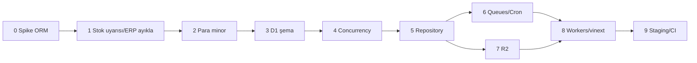

# Cloudflare uyarlama planı

**Dal:** `cloudflare-adaptation`  
**Proje:** Kaplan Turşu e-ticaret  
**Hedef runtime:** Cloudflare Workers + D1 + R2 + Queues / Cron

Bu belge, mevcut Next.js + PostgreSQL + Prisma + pg-boss yığınını Cloudflare-native yapıya taşıma yol haritasıdır.

---

## 1. Hedef mimari

```
İstek → Cloudflare Workers (Next / vinext)
              │
              ├─ D1          → uygulama verisi
              ├─ R2          → ürün / içerik görselleri
              ├─ Queues      → e-posta ve asenkron işler
              ├─ Cron        → süresi dolan sipariş, bakım
              └─ Turnstile   → bot koruması (isteğe bağlı, features.captcha)
```

| Bugün | Hedef |
|-------|--------|
| Node + `next start` | Workers (vinext) |
| PostgreSQL + Prisma `pg` | **D1** |
| Yerel disk (`UPLOAD_DIR`) | **R2** |
| `pg-boss` + `npm run worker` | **Queues** + **Cron Triggers** |
| Docker Compose (Postgres, Mailpit) | `wrangler dev` + local D1/R2 |

DNS, SSL ve domain Cloudflare üzerinden yönetilir.

---

## 2. Kapsam

### Dahil

- D1 şema ve repository uyarlaması
- Para alanlarının kuruş (`INTEGER`) modeline geçişi
- Stok / kredi limiti concurrency (D1-uyumlu)
- R2 dosya depolama adaptörü
- JobQueue → Cloudflare Queues + Cron
- Workers runtime (vinext), auth hash uyumu
- Staging deploy ve müşteri preview
- Dev / CI akışının Cloudflare araçlarına kayması

### Bilinçli olarak kapsam dışı

| Konu | Gerekçe |
|------|---------|
| **Stok uyarısı** (“gelince haber ver”, `stock-alerts`, sweep job) | Bu müşteri projesinde kullanılmayacak; migrasyonda taşınmaz, UI/job bağları kaldırılır veya ölü kod olarak bırakılmaz |
| **ERP senkronu** | `features.erp` zaten kapalı; Queue/Cron’a taşınmaz |
| Dış managed Postgres / Hyperdrive / PlanetScale | Karar: **yalnız D1** |
| PHP / paylaşımlı web hosting | Stack ile uyumsuz |
| Production PayTR live kesimi | Staging’de test/sahte ödeme; live ayrı go-live checklist |

Şablondaki `modules/stock-alerts`, `modules/erp` ve ilgili worker job kayıtları bu dalda **çıkarılır veya feature’sız bırakılıp deploy yolundan silinir** (tercihen kod ve cron’dan temizlenir).

### Kuyrukta kalacak işler (bizim ihtiyaç)

1. **E-posta gönderimi** (`email.send`) — asıl asenkron yük  
2. **Süresi dolan sipariş / rezervasyon temizliği** — Cron (ör. her 5 dk)  
3. **Bakım** — rate limit ve audit log purge — Cron  

---

## 3. Sabit teknik kararlar

1. **Veritabanı = D1 (SQLite).** Postgres migration zinciri taşınmaz; D1 için yeni baseline.
2. **Para = minor birim (kuruş).** DB’de `Int`; hesap/görüntüleme `src/shared/money.ts` üzerinden.
3. **ORM:** Önce spike — Prisma D1 adapter Workers’ta yeterince olgunsa Prisma; değilse **Drizzle + D1**.
4. Mevcut dikişler korunur:
   - `FileStorage` → `R2FileStorage`
   - `JobQueue` → `CloudflareJobQueue`
5. Native `@node-rs/argon2` → Workers-uyumlu hash (WebCrypto / WASM / pure JS).
6. E-posta: Workers’tan klasik SMTP kısıtlı olabilir → Queue consumer + desteklenen sağlayıcı (SMTP proxy veya transactional API) go-live öncesi netleşir.

---

## 4. Fazlar

### Faz 0 — Spike / ORM kararı ✅

**Karar: Prisma 7 + `@prisma/adapter-d1` (Workers) / `@prisma/adapter-better-sqlite3` (yerel).**

- Şema diyalekti: `provider = "sqlite"` (D1 ile aynı)
- Yerel: `DATABASE_URL=file:./dev.db`
- Workers: `env.DB` D1 binding
- Drizzle’a geçilmedi; Prisma Decimal alanları SQLite’ta string emülasyonu ile korunuyor (kuruş Int helper’ları `money.ts`’te hazır, şema Int dönüşümü sonraki harden)
- OpenNext (`@opennextjs/cloudflare`) + `wrangler.jsonc` iskeleti eklendi

---

### Faz 1 — Stok uyarısı ve ERP’yi kapsamdan düşürme ✅

**Durum:** `cloudflare-adaptation` dalında tamamlandı.

- `modules/stock-alerts`, `modules/erp`, worker job’ları, vitrin formu, `/bildirim-iptal`, admin stok talebi paneli kaldırıldı
- `BackInStockSubscription` şemadan düşürüldü (migration `20261101140000_drop_back_in_stock`)
- `features.erp` ve `ERP_*` env anahtarları kaldırıldı
- Worker yalnızca e-posta + sipariş release + maintenance kayıt eder

---

### Faz 2 — Para modeli (kuruş) 🟡

**Durum:** `toMinor` / `fromMinor` / yüzde / desi helper’ları ve birim testleri eklendi.  
Şema hâlâ Prisma `Decimal` (SQLite emülasyonu); kolonları `Int` minor’a çevirmek ayrı harden PR.

---

### Faz 3 — D1 şema + seed 🟡

**Durum:** Postgres migration’lar `prisma/migrations-archive/`; yeni SQLite baseline + D1 SQL.  
Cloudflare D1 `kaplan-eticaret` oluşturuldu (`e0697813-…`); baseline **43+ tablo** remote’a import edildi.  
**Eksik:** remote seed + admin.

---

### Faz 4 — Concurrency 🟡

**Durum:** `FOR UPDATE` kaldırıldı; stok koşullu `UPDATE` ile korunuyor. Rate limit Prisma upsert’e alındı.

---

### Faz 5 — Repository / D1 transaction ✅

**Durum:** Interaktif `$transaction(async …)` kaldırıldı; dizi formu + koşullu stok UPDATE + telafi adımları.  
`getDb()` D1 veya SQLite seçiyor.

---

### Faz 6 — Queues + Cron 🟡

**Durum:** Queue `kaplan-eticaret-jobs` oluşturuldu; `workers/app-worker.ts` queue + scheduled handler.  
Cron HTTP uçları hazır.  
**Eksik:** Deploy sonrası e-posta gönderim adapter’ı; secrets.

---

### Faz 7 — R2 ✅ (kaynak)

**Durum:** Bucket’lar oluşturuldu (`kaplan-eticaret-uploads`, `kaplan-eticaret-next-cache`). Kod adaptörü hazır.  
**Eksik:** Deploy sonrası upload smoke.

---

### Faz 8 — Workers (OpenNext) 🟡

**Durum:** OpenNext + custom worker + gerçek binding ID’leri.  
**Eksik:** `npm run deploy` (onay), secrets, seed, staging URL.

---

### Faz 9 — DevEx, CI, staging, müşteri preview

- `docker compose` Postgres bağımlılığı kalkar (Mailpit isteğe bağlı kalabilir veya mail API)
- CI: D1 migrate → unit → integration → e2e
- Staging secrets, seed, demo admin
- İsteğe bağlı Cloudflare Access ile müşteriye özel erişim
- Go-live checklist (domain, PayTR, gerçek mail, yedek)

**Çıkış:** Müşterinin bakabileceği HTTPS staging linki.

---

## 5. Sıra özeti



Faz 6 ve 7, Faz 5 sonrası paralel yürütülebilir. Faz 8’in iskeleti spike sonrası erken başlatılabilir; D1 bağlama Faz 3–5’e bağlıdır.

---

## 6. Tahmini süre (tek geliştirici)

| Faz | Süre |
|-----|------|
| 0 Spike | 1–3 gün |
| 1 Ayıklama | 0.5–1 gün |
| 2 Para | 3–5 gün |
| 3 D1 şema | 3–5 gün |
| 4 Concurrency | 2–4 gün |
| 5 Repository | 4–7 gün |
| 6 Queues/Cron | 2–4 gün (ERP/stok uyarısı yok → daha kısa) |
| 7 R2 | 1–2 gün |
| 8 Workers | 1–2 hafta |
| 9 Staging/CI | 2–3 gün |

**Toplam gerçekçi aralık:** ~4–7 hafta (vinext/ORM sürprizlerine göre).

---

## 7. Riskler

| Risk | Azaltma |
|------|---------|
| Prisma + D1 + Workers olgun değil | Faz 0’da Drizzle’a geçiş kararı |
| D1 yazma limitleri / tek-yazıcı semantiği | Conditional update + retry; kritik path testleri |
| Uzun transaction yok | Rezervasyon/ödeme adımlarını kısa tut |
| Para dönüşüm hatası | Minor helper + kapsamlı checkout testleri |
| SMTP Workers’ta | Erken mail sağlayıcı kararı |
| Next 16 ↔ vinext parity | Spike + özellik bazlı checklist |

---

## 8. Başarı kriterleri (MVP staging)

- [ ] Vitrin: kategori, ürün, sepet
- [ ] Checkout (misafir veya üye) + test/sahte ödeme
- [ ] Admin: ürün/sipariş temel işlemler
- [ ] Görsel R2’de
- [ ] Sipariş e-postası Queue üzerinden
- [ ] Süresi dolan sipariş Cron ile temizleniyor
- [ ] Stok uyarısı ve ERP yok / görünmüyor
- [ ] Müşteriye verilebilir HTTPS URL

---

## 9. İlk iş (bu dalda)

1. Faz 0 spike dalı / PR notu  
2. Faz 1: stok uyarısı + ERP worker ve UI yüzeyini ayıkla  
3. Faz 2 para tasarımını kilitle (`money` API taslağı)

Bu belge, uygulama ilerledikçe güncellenir; Faz 0 ORM kararı buraya işlenir.

---

## Faz 0 kararı: Drizzle + D1 (tamamlandı)

**Karar:** Prisma kaldırıldı, ORM olarak **Drizzle + D1** kullanılıyor.

**Neden:** Prisma'nın WASM sorgu derleyicisi Turbopack + OpenNext paketlemesinde projedeki tüm `.wasm` dosyalarını
(geliştirme araçlarındaki `playwright-core` dahil) sunucu paketine alıyor ve `wrangler deploy` çöküyordu.
Drizzle ile `.open-next` 748 MB → 66 MB, Worker paketi ~14 MB.

**Nasıl çalışıyor:**
- Şema: `src/db/schema/` (tek kaynak, alan dosyaları, elle sürdürülür). Migration'lar `db/migrations/NNNN_*.sql` (wrangler D1).
- `Decimal` (`decimal.js`) ve `Date` için özel kolon tipleri (`src/db/types.ts`): servis katmanı değişmedi.
- D1'de interaktif transaction yok: çok adımlı yazmalar `runBatch(db, [...])` ile tek atomik batch'te çalışır;
  kimlikler uygulamada üretilir. Stok için koşullu `UPDATE` (yarış testi geçiyor).
- D1 sorgu başına 100 bağlı parametre sınırı: uzun `IN (...)` listeleri `chunk()` ile, toplu eklemeler satır başına
  ekleme ile yapılır.
- Testler: bellek içi D1 (`tests/support/test-db.ts`, `getPlatformProxy`) üzerinde, canlıdaki ile aynı SQLite çalışma zamanı.
- Betikler: `npm run db:migrate-local`, `db:seed`, `create-admin` (hepsi `--remote` destekler).

**Bilinen sınırlar:**
- `cacheComponents` / `partialPrefetching` (PPR) kapalı: OpenNext üretim Worker'ında sayfalar 500 dönüyordu.
- Parola hash'i saf JS argon2id: ~1 sn CPU/işlem (Workers ücretli planda sorun değil; ücretsiz planda çalışmaz).
- E-posta kuyruğu tüketicisi hâlâ bir `TODO` (e-postalar gönderilmez).
